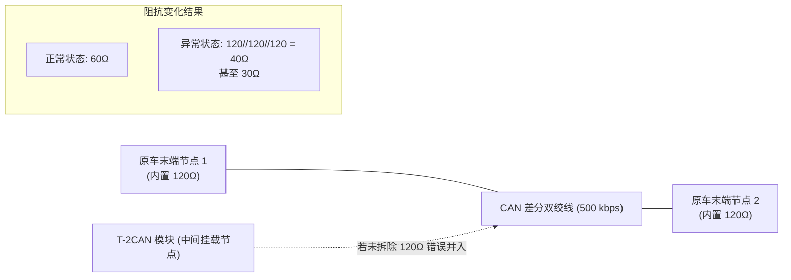

# 02-硬件修改与物理焊接实操指南

本篇详细阐述在使用 **LILYGO T-2CAN** 开发板接入特斯拉整车总线前，**必须执行的硬件物理修改**。若未完成关键修改直接装车，轻则通信丢包、手机热点频繁断连，重则导致车载网关报警并禁用辅助驾驶功能。

---

## 一、 核心强制修改：拆除板载两颗 120Ω 终端电阻

### 1. 为什么必须拆除终端电阻？（原理深度剖析）

根据 **ISO 11898-2 高速 CAN 总线电气标准**：
* CAN 总线为双绞线差分传输结构，特性阻抗通常为 **120 Ω**。
* 为消除高频信号在传输线末端的阻抗突变与反射波，标准的 CAN 网络只允许在**最远的两端物理终端节点**各放置一颗 **120 Ω 终端电阻**。
* 整车正常工作时，两颗 120 Ω 电阻并联，整车总线两端在断电状态下测量的等效直流阻抗为：
  $$R_{\text{total}} = \frac{120\,\Omega \times 120\,\Omega}{120\,\Omega + 120\,\Omega} = \mathbf{60\,\Omega}$$



### 2. 未拆除 120Ω 终端电阻的实车严重后果
1. **总线负载阻抗被严重拉低**：T-2CAN 是作为**总线中间监听/注入节点**并入的。如果 T-2CAN 板载的 120 Ω 电阻未拆除，整车总线阻抗将变为 $60\,\Omega \parallel 120\,\Omega = \mathbf{40\,\Omega}$。若两路 CAN 均未拆除，整车总线阻抗将异常跌落至 **30~40 Ω**。
2. **差分驱动电平不足与信号失真**：CAN 收发器输出的显性电平（Dominant）电流受限，差分电压幅值（$V_{\text{diff}} = V_{\text{CANH}} - V_{\text{CANL}}$）达不到标准判定阈值，造成严重的信号反射和眼图畸变。
3. **触发车辆网关报故障码与 AP 降级**：特斯拉车载网关（Gateway）具备总线电气诊断与 CRC 错误帧计数监控。一旦总线阻抗异常，网关会记录大量位填充错误（Stuff Error）和应答错误（ACK Error），触发 `DAS_a027`、`GTW_w018` 等故障警报，直接切断 Autopilot，仪表盘弹出“辅助驾驶功能受限/不可用”。

---

## 二、 终端电阻拆除实操定位与步骤

### 1. 目标电阻位置识别
在 **LILYGO T-2CAN** 板上，两路 CAN 物理接口旁各布置了一颗用于终端匹配的 0603/0805 贴片电阻：
* **阻值丝印**：标有 `1200`（120 × $10^0 = 120\,\Omega$）或 `121`（12 × $10^1 = 120\,\Omega$）。
* **对应位置**：
  - **CAN A (MCP2515 侧)**：位于 MCP2515 芯片与 CAN A 外部接线端子之间。
  - **CAN B (TWAI 侧)**：位于 CAN B 收发器芯片（如 SN65HVD230 / SIT65HVD230）与 CAN B 接线端子之间。

```
              ┌────────────────────────────────────────────────────────┐
              │                     LILYGO T-2CAN                      │
              │                                                        │
   CAN A 接口 │ [CAN_H] [CAN_L]                                        │
              │    │        │                                          │
              │    └──[R_A]─┘  <--- ★ 需拆除此贴片电阻 R_A (120Ω)      │
              │   (MCP2515)                                            │
              │                                                        │
              │   (ESP32-S3)                                           │
              │                                                        │
   CAN B 接口 │ [CAN_H] [CAN_L]                                        │
              │    │        │                                          │
              │    └──[R_B]─┘  <--- ★ 需拆除此贴片电阻 R_B (120Ω)      │
              │   (TWAI PHY)                                           │
              └────────────────────────────────────────────────────────┘
```

### 2. 拆除操作规范
1. **工具准备**：热风枪（设定温度 320℃~350℃）或尖头电烙铁、精密镊子、焊油/助焊膏、无水酒精、棉签。
2. **热风枪拆卸法（推荐）**：
   - 用耐高温胶带（卡普顿胶带）贴在周边的电容、晶振与主控芯片上做热隔离保护；
   - 涂抹微量助焊剂在 120Ω 贴片电阻引脚；
   - 垂直加热电阻 3~5 秒，用镊子轻轻移走贴片电阻；
   - 用酒精清洁残留松香。
3. **烙铁单侧堆锡法**：
   - 给电阻两端引脚加锡形成一个焊锡连通球，双侧引脚同时受热后用镊子挑落；
   - 使用吸锡带清理焊盘，确保两焊盘之间**绝对不能短路**（保持开路）。
4. **万用表测量验证（必须打表）**：
   - 拆除后，用万用表电阻档测量板载 CAN A 的 `CAN_H` 与 `CAN_L` 之间阻抗：应显示**开路（无穷大或兆欧级）**；
   - 测量板载 CAN B 的 `CAN_H` 与 `CAN_L` 之间阻抗：应显示**开路（无穷大或兆欧级）**；
   - 测量确认合格后方可进行后续装配。

---

## 三、 RF 射频天线优化改造（解决车机/手机断连）

### 1. 车载环境射频衰减痛点
* 特斯拉中控屏后部、扶手箱内部包覆了密集的冲压金属支架、铝合金横梁与线束屏蔽网，对 2.4GHz 射频电磁波形成明显的**法拉第笼屏蔽效应**。
* 若直接使用板载 PCB 板载天线，放入仪表台后：
  - 手机连接热点（`T2CAN-****`）信号极弱，频繁掉线；
  - 与转向拨杆/中控台上的 **S3XY 实体按键** BLE 连接不稳定，按键响应延迟甚至丢失。

### 2. 外部天线引出改造方案
1. **硬件选型**：采购带有 **IPEX (U.FL) 射频座** 版本的 T-2CAN 板子（或确保板载 0 欧电阻跳线连接到了 IPEX 底座而非板载倒 F 天线）。
2. **天线规格**：选配 **2.4GHz 3dBi~5dBi 全向车规级软贴片胶条天线（附 15cm~30cm 屏蔽同轴线）**。
3. **布线路径**：
   - T-2CAN 主板固定在仪表台或扶手箱内部；
   - 同轴馈线顺着饰板缝隙引出至**塑料饰板外侧、储物盒内壁或中控下方非金属包覆区域**粘贴，确保天线周围 3cm 无大面积金属板。

---

## 四、 电源防反接与抗干扰保护电路

如果未采用外壳一体化成品模块，而是自己连接 DC-DC 降压板与开发板，请务必按以下保护电路补强：

```
车载 12V/16V (+) ────[ 1A 保险丝 ]────[ SS34 肖特基二极管 ]────┬───────── [ DC-DC 降压输入 VIN ]
                                                              │
                                                        [ SMBJ24A TVS ]
                                                              │
车载地线 GND  (─) ────────────────────────────────────────────┴───────── [ DC-DC 降压输入 GND ]
```

* **1A 快速熔断自恢复保险丝**：防止后级芯片击穿短路引发车内取电线路过载。
* **SS34 肖特基二极管**：实现极低压降（<0.3V）的电源防反接保护。
* **SMBJ24A / SMBJ28A 车规 TVS 管**：吸收车辆发电机和继电器切断时的瞬态尖峰脉冲电压。
