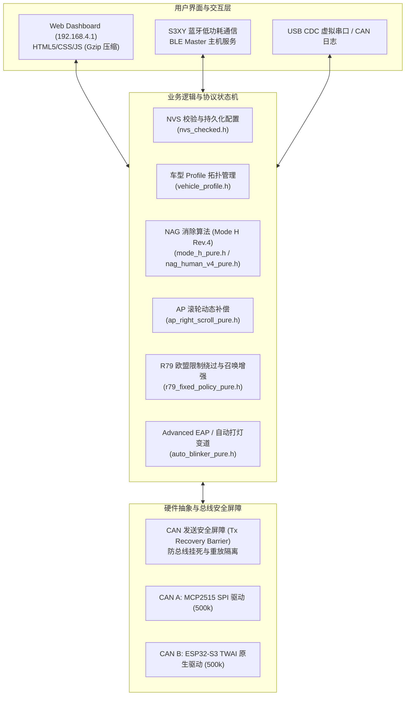

# 03-软件架构与车型适配指南

本文档全面梳理 [t2can-universal-unlock v3.29.1](https://github.com/hanliang33-cyber/t2can-universal-unlock) 的底层软件架构、车型配置矩阵、通信协议注入算法、编译配置与测试验证流程。

---

## 一、 软件系统分层与代码架构

代码采用清晰的**模块化与纯逻辑隔离架构（Pure Header Pattern）**：
* 业务逻辑与算法以 `_pure.h` 结尾，完全解耦硬件依赖，可在 PC/Host 环境直接运行 Python/C++ 单元测试与契约测试。
* 硬件与总线驱动以 `_runtime.h` 结尾，负责 ESP32-S3 TWAI、MCP2515 SPI 驱动、RTOS 任务调度与中断管理。



---

## 二、 五大车型 Profile 与总线拓扑支持矩阵

系统通过 NVS 保存当前车辆 Profile，首次启动或固件升级后自动进入**安全配置引导模式（Safe Setup Mode）**，必须在 Web 界面选择并保存匹配的车型，方才激活 CAN 发送与功能注入。

| 车型代号 (`VehicleProfileId`) | 车型商业名称 | 支持的总线拓扑 (`VehicleCanTopology`) | 转向类型 (`TurnSignalVariant`) | 核心功能支持情况 |
| :--- | :--- | :--- | :--- | :--- |
| **`VEHICLE_MODEL_YL` (1)** | **Model Y L** | `YL_PARTY_VH`<br>(CAN A: Party, CAN B: VH) | 物理拨杆 (STALK) | • NAG 消除（扭矩注入）<br>• Advanced EAP 自动打灯<br>• 电门响应映射 (Pedal Map)<br>• EU R79 解锁 |
| **`VEHICLE_MODEL_Y_LEGACY` (3)** | **Model Y (Legacy 2019-2023)** | ① `STANDARD_BODY_CHASSIS` (默认)<br>② `STANDARD_PARTY_CHASSIS` | 物理拨杆 (STALK) | • 拓扑①：EAP自动打灯、滚轮NAG、EU解锁<br>• 拓扑②：扭矩NAG、EU解锁（无自动打灯） |
| **`VEHICLE_MODEL_Y_JUNIPER` (2)** | **Model Y Juniper (2025+)** | `STANDARD_BODY_CHASSIS`<br>(CAN A: Body, CAN B: Chassis) | 物理拨杆 (STALK) | • 焕新版兼容协议<br>• Advanced EAP 自动打灯<br>• EU 解锁与召唤增强 |
| **`VEHICLE_MODEL_3_HIGHLAND` (4)** | **Model 3 Highland (焕新版)** | `STANDARD_BODY_CHASSIS`<br>(CAN A: Body, CAN B: Chassis) | **可选：STALK (加装拨杆) 或 STALKLESS (方向盘按键/屏幕)** | • 适配按键打灯与屏幕转向协议<br>• Advanced EAP 自动打灯<br>• EU 解锁与滚轮 NAG |
| **`VEHICLE_MODEL_3_LEGACY` (5)** | **Model 3 (Legacy 2017-2023)** | ① `STANDARD_BODY_CHASSIS` (默认)<br>② `STANDARD_PARTY_CHASSIS` | 物理拨杆 (STALK) | • 支持 0x39B / 0x399 传统网关协议<br>• 完整高级 AP 与 EU 解锁 |

---

## 三、 核心注入功能与算法实现机理

### 1. NAG 提醒消除算法 (NAG Killer)
特斯拉在 AP/FSD 状态下会检测驾驶员双手是否对方向盘施加了轻微阻尼扭矩或按压滚轮：
* **扭矩拟人注入 (Mode H Rev.4)**：
  - 在 Party CAN 上对 EPS 电动助力转向报文（`0x129` / `0x118` 等相关状态）进行分析；
  - 动态施加拟人微扭矩（主阈值 `1.80~2.60 Nm`，防反作用力载波 `0.10~0.60 Nm`，拟人等待间隔 `0.90~3.00 s`）；
  - **车速为 0 km/h 时强制暂停注入**（避免红绿灯停车等待时方向盘异响抖动）；
  - **物理接管秒级避让**：检测到驾驶员主动施加超过 `2.00 Nm` 扭矩时，算法瞬时退让熔断。
* **右滚轮按键模拟 (AP Right Scroll)**：
  - 监听 `0x24A` (DAS 视觉告警信号) 或 `0x399` / `0x39B` 报文；
  - 一旦视觉告警灯点亮（提示握紧方向盘），立刻在 Chassis CAN 注入一组连续的 `UP / DOWN` 滚轮按键微操；
  - 物理右滚轮操作享有绝对优先权。

### 2. 欧盟 R79 协议解锁与增强召唤 (EU Unlock & Summon)
在欧洲及国标等部分区域，车辆受到联合国 ECE R79 法规约束（横向加速度不得超标、弯道减速、打灯变道 5 秒超时退出、召唤范围限制在 6 米以内）：
* **报文标志位重构 (Chassis CAN / CAN B)**：
  - `UI_applyEceR79` (第 19 位)：强制置为 `0`（解除 R79 严苛法规限制）；
  - `UI_hardCoreSummon` (第 47 位)：强制置为 `1`；
  - 扩展召唤（Smart Summon）有效半径至 **±85 米**；
  - 变道超时取消解除：打灯变道不再有 5 秒超时强制熔断限制；
  - 匝道与岔路自动变道选择解除限制。

### 3. 高级增强辅助驾驶与自动打灯 (Advanced EAP)
* 监听车辆自动辅助导航驾驶（NOA）发出的变道意图信号（`DAS_autoLaneChangeState`）；
* 状态机经安全防抖校验确认后，自动在 Body CAN 上触发相应方向的转向灯信号；
* 仪表盘、开门按键或 S3XY 实体按键均可**随时一键取消变道**，确保完全可控。

---

## 四、 编译、烧录与工程化配置

### 1. 使用 PlatformIO 编译与烧录（推荐）
工程已配置完整的 [platformio.ini](file:///D:/DSHbot/t2can-universal-unlock/platformio.ini) 与 [partitions_16mb.csv](file:///D:/DSHbot/t2can-universal-unlock/partitions_16mb.csv)。

#### 常用命令：
```bash
# 1. 编译固件
pio run

# 2. 烧录固件与分区表 (连接 USB 串口)
pio run --target upload

# 3. 启动串口监视器 (115200 波特率)
pio run --target monitor
```

### 2. 使用 Arduino IDE 编译配置参数
若使用 Arduino IDE (2.x)，请在“工具 (Tools)”菜单中进行以下严格配置：
* **开发板 (Board)**: `ESP32S3 Dev Module`
* **CPU Frequency**: `240MHz (WiFi)`
* **Flash Mode**: `QIO 80MHz`
* **Flash Size**: `16MB (128Mb)`
* **Partition Scheme**: `16M Flash (3MB APP/9.9MB FAT)` 或加载自定义 `partitions_16mb.csv`
* **PSRAM**: `OPI PSRAM`
* **USB Mode**: `Hardware CDC and JTAG`
* **USB CDC On Boot**: `Enabled`（★ 必须开启，否则固件编译报错并无法输出 CAN 日志）
* **Upload Mode**: `UART0 / Hardware CDC`

---

## 五、 实车上电调试与 Web 仪表台配置流程

1. **首次上电启动**：
   - 将烧录好且已拆除 120Ω 终端电阻的 T-2CAN 模块接入特斯拉对插线束并通电；
   - 此时板卡进入安全配置模式，CAN 注入处于锁定状态，Wi-Fi 广播开启。
2. **连接热点**：
   - 手机或电脑搜索 Wi-Fi 热点：`T2CAN-xxxx`；
   - 默认密码：`12345678`。
3. **访问控制面板**：
   - 打开浏览器访问：`http://192.168.4.1`；
   - **第一步**：进入 **Setup**，根据实际车型选择并保存你的 **Vehicle Profile**（如 `Model Y Legacy` + `Body + Chassis`）；
   - **第二步**：系统应用配置并激活 CAN 通信，进入 **HOME** 页面观察 CAN A 和 CAN B 的报文计数器（每秒正常应有上千帧数据更新）；
   - **第三步**：在 **DEVICES** 中扫描配对 S3XY 按键，在 **SETTINGS** 中开启 NAG Killer 与 Advanced EAP。
